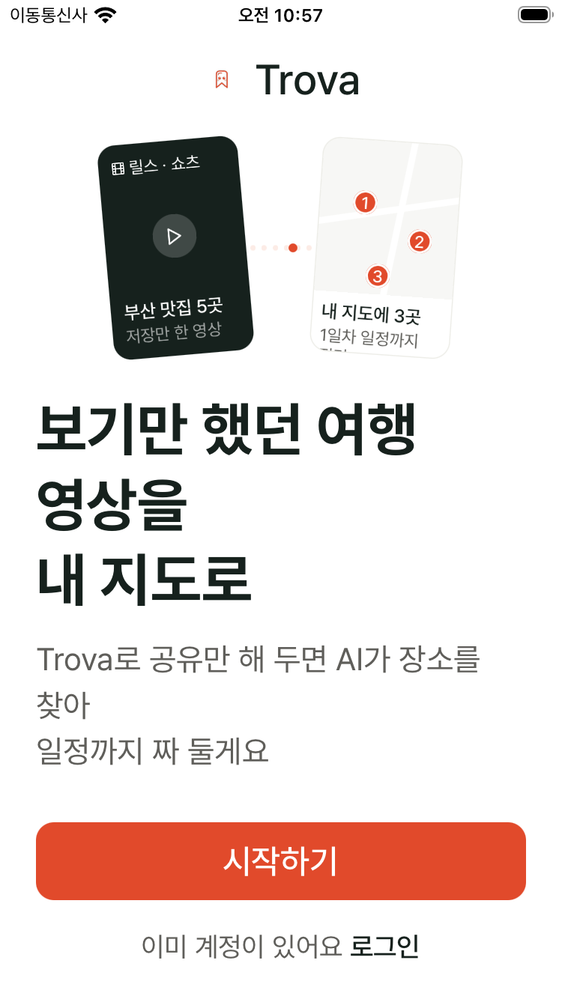
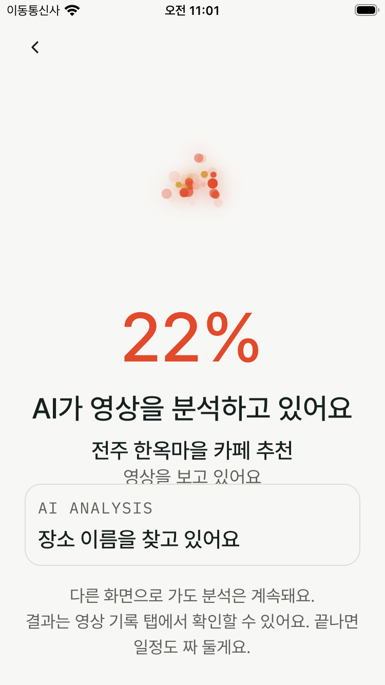
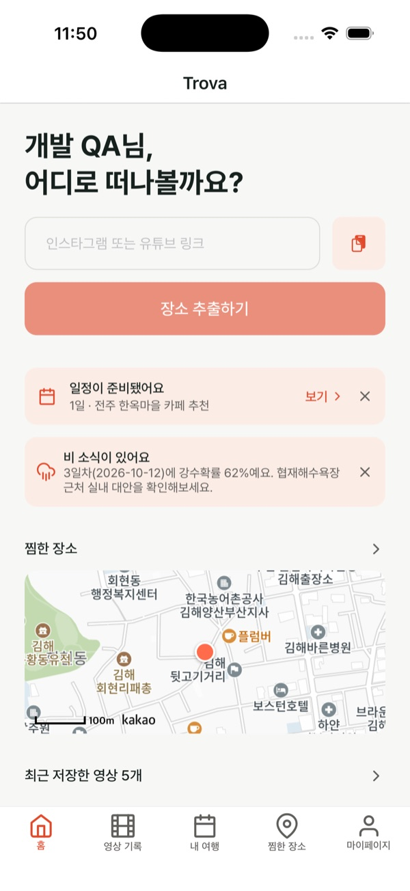
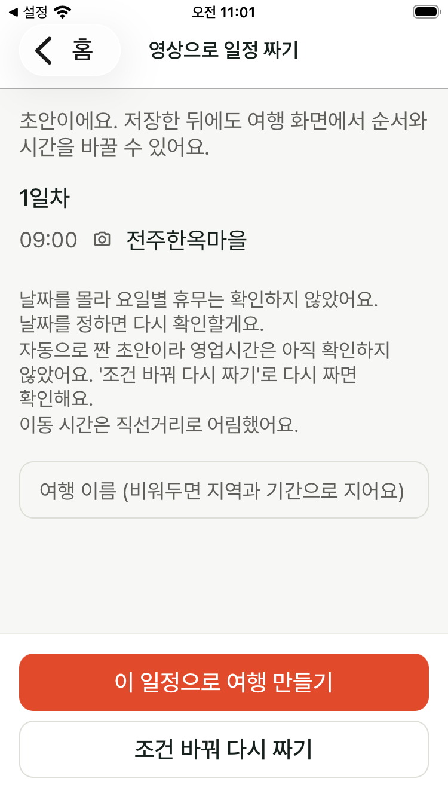
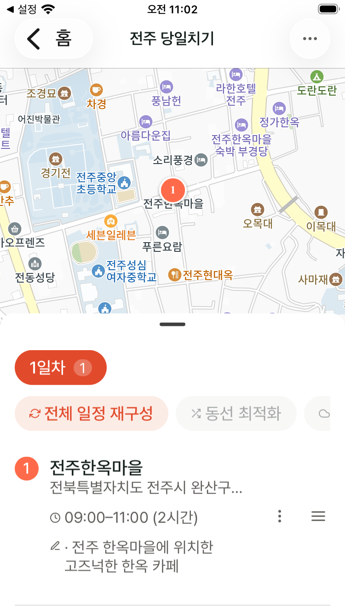

# Trova

### 보기만 했던 여행 영상을, 내 여행으로

인스타그램·유튜브에서 발견한 장소를 지도에 모으고, 
AI가 만든 일정 초안을 나만의 여행으로 완성하세요.

[앱 코드](https://github.com/Trovapp/trova-app) · [백엔드](https://github.com/Trovapp/trova-backend) · [개인정보처리방침](https://trovapp.github.io/privacy/) · [이용약관](https://trovapp.github.io/terms/)

## 저장해 둔 영상이 여행이 되도록

릴스와 쇼츠에서 찾은 맛집과 여행지. 나중에 가려고 저장했지만, 막상 여행을 준비하면 영상을 다시 보며 장소를 검색하고 일정을 짜야 합니다.

Trova는 링크 하나에서 시작합니다. AI가 콘텐츠 속 장소를 찾아 지도에 정리하고 일정 초안까지 만듭니다. 마음에 드는 초안을 여행으로 저장한 뒤, 방문 순서와 시간을 바꾸며 계획을 완성할 수 있습니다.

## 앱 미리보기

| 처음 만나는 Trova | 링크를 넣고 AI 분석 | 준비된 일정 확인 |
| :---: | :---: | :---: |
|  |  |  |

| AI가 만든 일정 초안 | 내 여행으로 저장 |
| :---: | :---: |
|  |  |

실제 앱의 테스트 계정으로 촬영한 화면입니다. 캡처 시점에 따라 현재 화면과 차이가 있을 수 있습니다.

## 이렇게 사용해요

1. **링크 공유** — 인스타그램 릴스·게시물 또는 유튜브 영상·쇼츠 링크를 Trova에 넣습니다.
2. **장소 모으기** — AI가 찾아낸 장소를 지도와 영상 기록에서 확인하고, 찜과 폴더로 정리합니다.
3. **일정 만들기** — 자동으로 준비된 초안을 확인하거나 여러 영상의 장소를 모아 원하는 조건으로 일정을 만듭니다.
4. **여행 완성하기** — 초안을 승인해 여행으로 저장하고, 순서·시간을 편집하거나 동선을 최적화합니다.

여행 중에도 대체 장소와 빈 시간에 갈 곳을 추천받고, 대화형 비서에게 취향을 전달할 수 있습니다. 여행 날짜의 비 소식과 실내 대안을 확인하고 일정을 다시 구성하는 기능도 제공합니다.

## 기술적으로 구현한 것

| 영역 | 구현 내용 |
| --- | --- |
| AI 장소 추출 | 콘텐츠에 따라 영상 링크, 음성, 화면 프레임, 사진과 설명을 Gemini에 전달해 장소를 추출합니다. 카카오 로컬 검색으로 위치 후보를 찾고, 모호한 후보는 추가 선택·검증을 거칩니다. |
| 비동기 분석 | Spring Boot에서 분석 작업을 접수하고 Kafka 또는 내부 실행기로 처리합니다. 중복 제출과 중복 실행을 억제하고, 진행 단계와 실패 상태를 관리합니다. |
| AI 일정 생성 | LangGraph4j로 초안 생성 → 코드 보정 → 규칙 검증 → AI 수정 흐름을 구성했습니다. AI 수정은 최대 두 번 수행하며, 검증 오류가 가장 적은 초안을 선택합니다. 여행 저장은 사용자 승인 후 진행합니다. |
| 동선 최적화 | 장소 10개 이하에서는 Held–Karp 동적 계획법으로 최단 방문 순서를 계산하고, 그보다 많으면 근사 방식을 사용합니다. 고정한 장소와 좌표 없는 장소를 고려합니다. |
| 개인화·대화 | PostgreSQL의 pgvector로 취향 신호를 검색해 추천 순위에 반영합니다. 대화형 비서는 도구 호출을 통해 대체 장소·빈 시간 추천과 취향 기록을 수행합니다. |
| 운영·관측 | Oracle Cloud에서 서비스를 운영하며, Micrometer·Prometheus·Grafana로 분석 단계, 외부 API 호출, 큐 대기와 JVM 자원을 관찰합니다. |

**App** · React Native · Expo · TypeScript · TanStack Query · Kakao Maps 
**Backend** · Java 21 · Spring Boot · Spring Security · JPA · Spring AI 
**AI & Data** · Python · Gemini · yt-dlp · ffmpeg · PostgreSQL · pgvector 
**Infrastructure** · Oracle Cloud · Caddy · systemd · Kafka · Prometheus · Grafana

## 저장소

| 저장소 | 역할 |
| --- | --- |
| [trova-app](https://github.com/Trovapp/trova-app) | React Native·Expo 기반 앱과 웹/PWA |
| [trova-backend](https://github.com/Trovapp/trova-backend) | API 서버, AI 분석 파이프라인, 일정 생성과 추천 |
| [trova-frontend](https://github.com/Trovapp/trova-frontend) | 별도 웹 프론트엔드 |
| [trovapp.github.io](https://github.com/Trovapp/trovapp.github.io) | 개인정보처리방침·이용약관·이용 안내 |
| [Trovapp](https://github.com/Trovapp/Trovapp) | 서비스 소개와 화면 미리보기 |

일부 코드 저장소는 비공개로 운영하고 있습니다.
